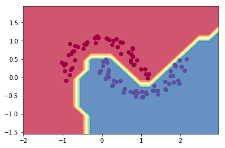
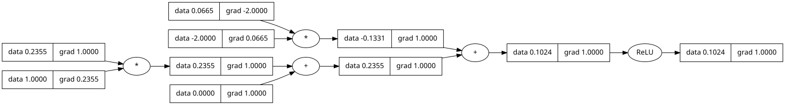

# micrograd

<p align="center">
  <a href="https://github.com/karpathy/micrograd/blob/master/README.md">English</a> · <b>简体中文</b>
</p>


极简小巧但五脏俱全的自动求导引擎（Autograd engine）。基于动态构建的有向无环图（DAG）实现反向传播（反向模式自动微分），并在其之上提供了一套具有类似 PyTorch 风格 API 的轻量级神经网络库。两者代码都极其轻量，核心分别仅有约 100 行与 50 行代码。DAG 仅在标量值（scalar values）上运作，因此每个神经元都会被细拆为其最基础的加法和乘法细粒度算子。尽管如此，正如示例 Notebook 所展示的那样，这已完全足以构建出能够进行二分类任务的完整深度神经网络。该项目非常适合用于深度学习与自动微分教学。

### 安装

```bash
pip install micrograd
```

### 使用示例

以下是一个略具代表性的使用示例，展示了 micrograd 支持的多种基础运算：

```python
from micrograd.engine import Value

a = Value(-4.0)
b = Value(2.0)
c = a + b
d = a * b + b**3
c += c + 1
c += 1 + c + (-a)
d += d * 2 + (b + a).relu()
d += 3 * d + (b - a).relu()
e = c - d
f = e**2
g = f / 2.0
g += 10.0 / f
print(f'{g.data:.4f}') # 输出 24.7041，即前向传播计算结果
g.backward()
print(f'{a.grad:.4f}') # 输出 138.8338，即 dg/da 的数值梯度
print(f'{b.grad:.4f}') # 输出 645.5773，即 dg/db 的数值梯度
```

### 训练神经网络

Jupyter 交互式笔记本 `demo.ipynb` 提供了一个训练 2 层神经网络（MLP）二分类器的完整演示。通过从 `micrograd.nn` 模块初始化神经网络，实现简易 SVM "最大间隔（max-margin）" 二分类损失函数，并使用随机梯度下降（SGD）进行参数优化。正如 Notebook 中所示，使用包含两个 16 节点隐藏层的 2 层神经网络，可以在半月形数据集（moon dataset）上得到如下决策边界：



### 训练 GPT 模型

如需更进阶的范例，请参阅 [microgpt](https://gist.github.com/karpathy/8627fe009c40f57531cb18360106ce95)。该项目在纯粹、无外部依赖的原生 Python 中完成了一个完整的类 GPT-2 Transformer 模型的训练与文本采样。它构建在此处自动求导引擎的一个更高性能、更优化的版本之上（在前向传播时存储局部梯度，而非为每个算子保存反向闭包），并将整个完整算法浓缩在单个独立文件中 - 其余一切设计均只为追求执行效率。详细代码走读亦可参阅配套的[原理解析博文](https://karpathy.github.io/2026/02/12/microgpt/)。

### 图追踪与可视化

为便于调试，笔记本 `trace_graph.ipynb` 提供了生成 Graphviz 计算图可视化的功能。例如，以下是对单个简单 2 维神经元的计算图可视化展示（通过对下方代码调用 `draw_dot` 生成），清晰展现了每个节点中的数据值（各节点左侧数值）与梯度值（各节点右侧数值）：

```python
from micrograd import nn
n = nn.Neuron(2)
x = [Value(1.0), Value(-2.0)]
y = n(x)
dot = draw_dot(y)
```



### 运行单元测试

运行单元测试需要安装 [PyTorch](https://pytorch.org/)。测试套件将其作为参考基准，用于严格校验所计算梯度的正确性。安装后直接执行：

```bash
python -m pytest
```

### 开源许可证

MIT License

---

> **翻译说明（Translation Disclaimer）**
> 本文档由社区开发者维护，旨在降低中文开发者的阅读门槛。最后同步日期：2026年11月17日。若译文与英文原版存在任何出入或滞后，请以 [英文原版 (README.md)](https://github.com/karpathy/micrograd/blob/master/README.md) 为准。欢迎通过 PR 协助改进译文！
